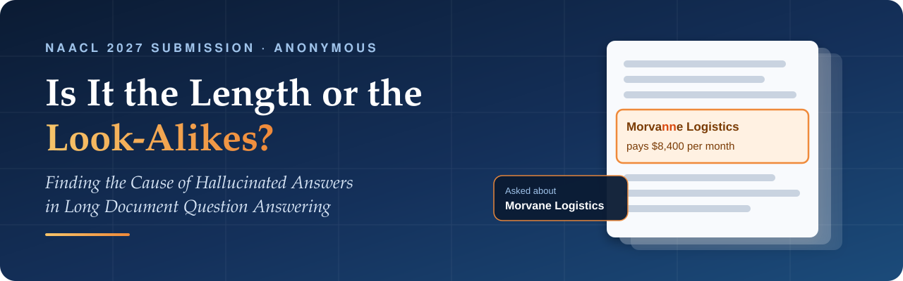
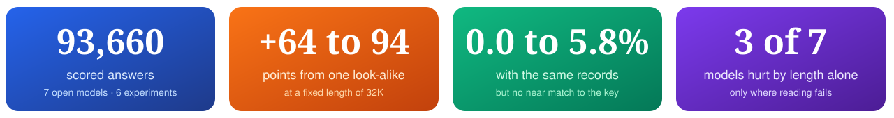
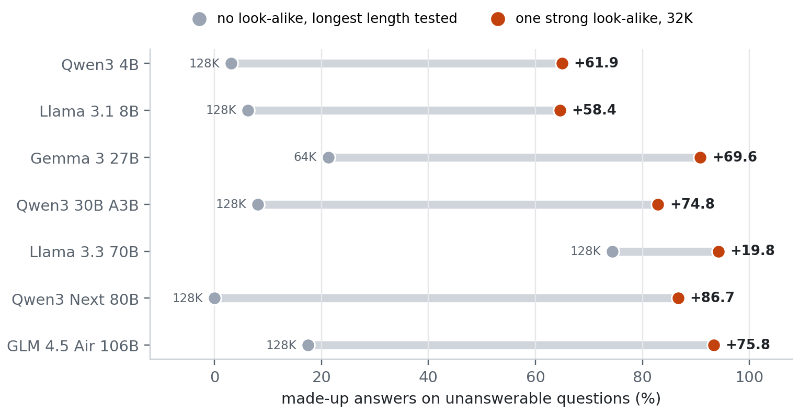
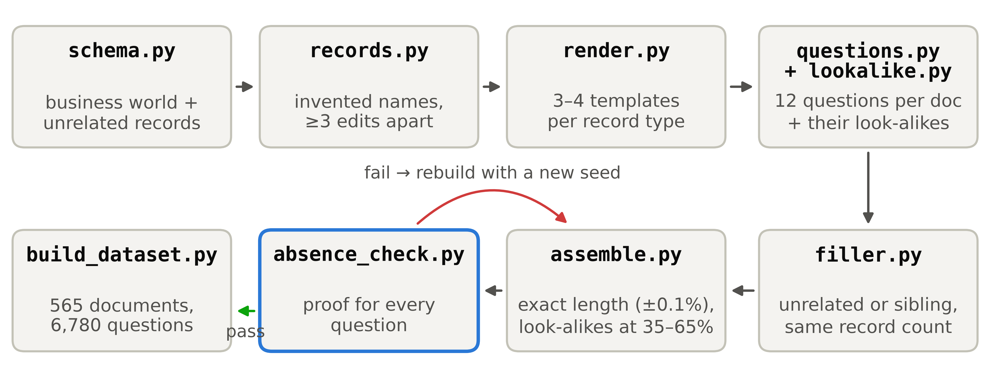
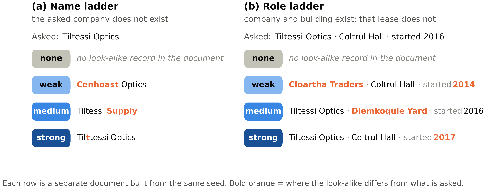
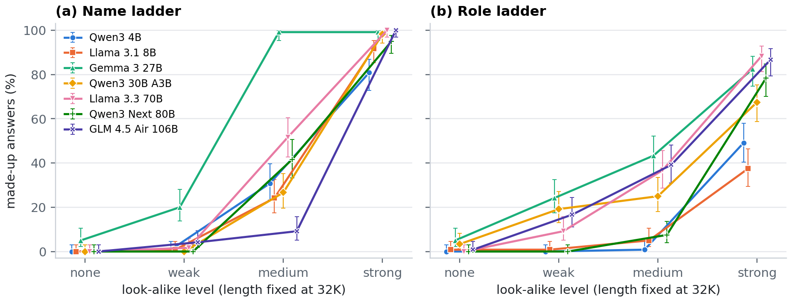
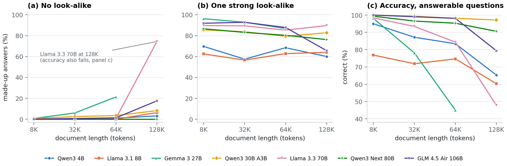
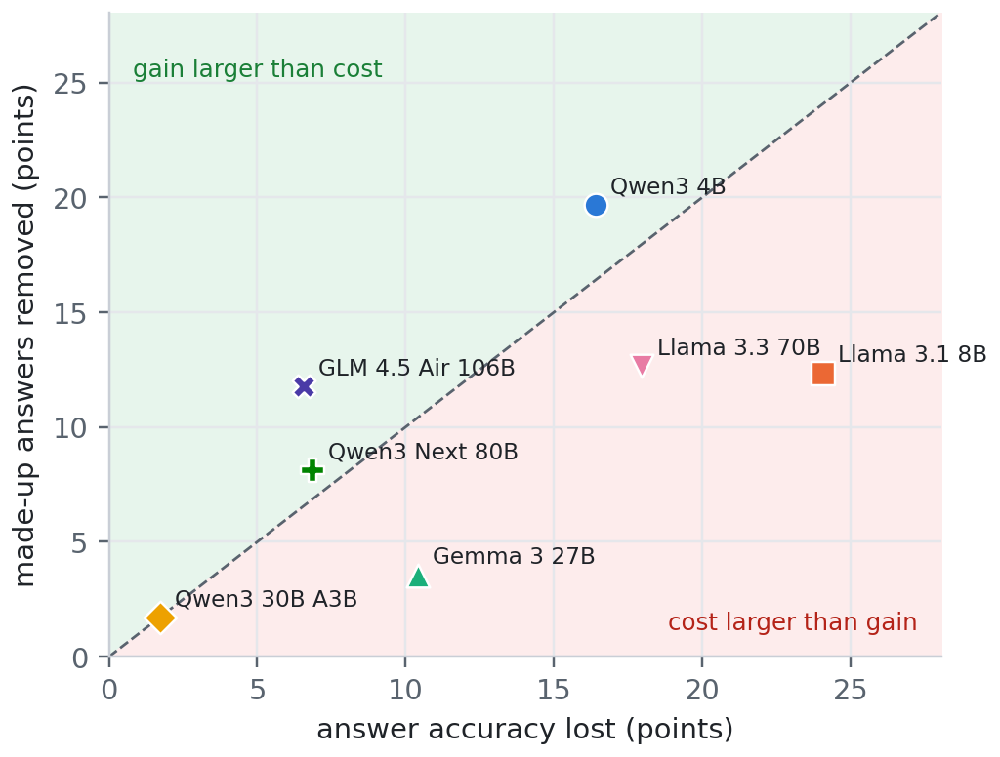
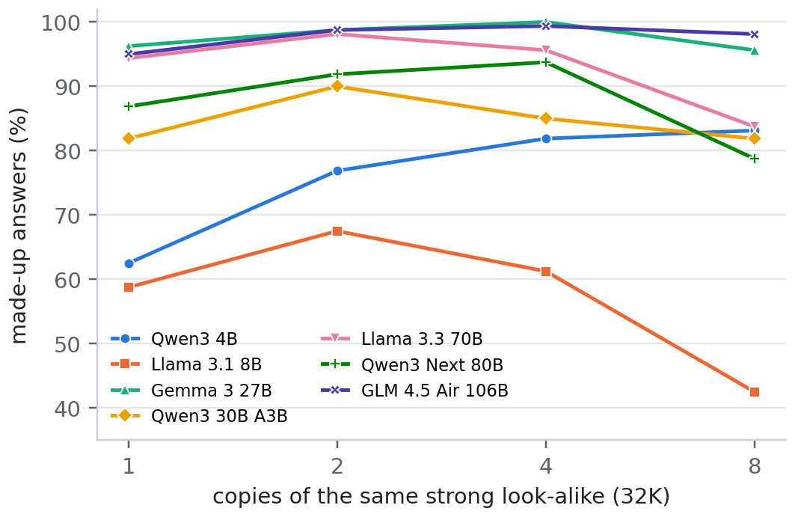
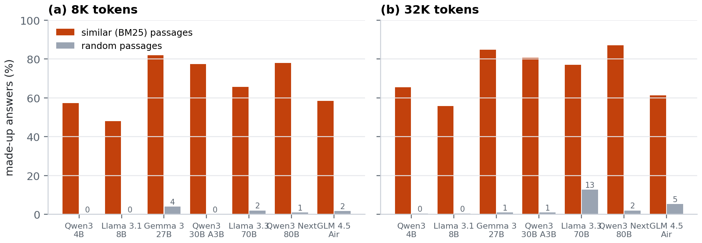

<p align="center">
  
</p>

<p align="center">
  <a href="#-quick-start"></a>
  <a href="#-results"></a>
  <a href="#-what-is-released"></a>
</p>

<p align="center">
  
  
  
  
  
  
  
</p>

<p align="center">
  
</p>

> [!NOTE]
> This repository is anonymized for double-blind review at **NAACL 2027**. Experiment numbers follow the **paper**.
> The code keeps its internal folder names, and the [Experiments](#-experiments) table maps one to the other.

<table>
<tr>
<td width="33%" valign="top">

### 🧩 The question
When the answer is **not** in a long document, language models often **make one up**, and published rates rise with length. But longer documents also hold more records that **look like** the asked one.

</td>
<td width="33%" valign="top">

### 🔬 What we do
**NullScale** builds long documents where length and look-alikes are set **separately** and the answer is **proven absent**. We score every answer with fixed rules, with no LLM judge.

</td>
<td width="33%" valign="top">

### 🎯 What we find
One strong look-alike causes most made up answers. The same records **without a near match** to the asked key cause none. Length alone hurts only **3 of 7** models, and only where reading fails.

</td>
</tr>
</table>

---

## 📑 Contents

<table>
<tr>
<td>

1. [Key findings](#-key-findings)
2. [What is released](#-what-is-released)
3. [The NullScale generator](#-the-nullscale-generator)
4. [Experiments](#-experiments)
5. [Results](#-results)

</td>
<td>

6. [Annotation](#-annotation)
7. [Quick start](#-quick-start)
8. [Reproducing the paper](#-reproducing-the-paper)
9. [Repository layout](#-repository-layout)
10. [File formats](#-file-formats)

</td>
<td>

11. [Models and compute](#-models-and-compute)
12. [Limitations](#-limitations)
13. [Citation](#-citation)
14. [License](#-license)

</td>
</tr>
</table>

---

## ✨ Key findings

<p align="center">
  
</p>
<p align="center"><sub><b>Figure 1.</b> Made up answers on unanswerable questions. Grey bars show no look-alike at the longest length each model was run (64K or 128K). Orange bars show one strong look-alike in a 32K document.</sub></p>

| | | Finding |
|:-:|---|---|
| 🟧 | **RQ1 · One look-alike** | At a fixed 32K, one strong look-alike raises made up answers by **64 to 94 points** in all seven models. In six models, **94% to 99%** of these answers copy the look-alike's value. |
| 🟩 | **Causal control** | The same eight extra records, with **no near match** to the asked key, give **0.0% to 5.8%**, the same as no look-alike. Strong look-alikes sit **58.3 to 94.6 points** higher in every model. |
| 🟦 | **RQ2 · Length** | With the same filler, no look-alike at the longest length stays **42 to 95 points** below a strong look-alike at 32K in six models. Length alone does large damage only in **Gemma 3 27B, Llama 3.3 70B and GLM 4.5 Air 106B**, where reading accuracy has already fallen. The look-alike effect never grows significantly with length. |
| 🟪 | **RQ3 · RIKER2** | Trap questions with a look-alike stay flat at **63%, 62%, 61%**, and so does their number per question (**0.79, 0.78, 0.76**). The look-alike effect is positive only at 32K (**+23.4 points**). |
| 🟨 | **RQ4 · Sibling padding** | Lowers made up answers by **1.8 to 19.7 points** but costs **1.7 to 24.1 points** of accuracy, mostly through more refusals. |
| 🌍 | **Real text** | On Natural Questions with every answer passage removed, similar Wikipedia passages give **48.0% to 87.0%** made up answers, random ones **0.0% to 12.7%**. |
| 📞 | **Protocol** | Asking all 12 questions in one call raises made up answers by **12.5** (Qwen3 4B) and **37.5 points** (Llama 3.1 8B). |
| ✅ | **Scoring** | Our fixed rules agree with the official RIKER2 scorer on **99.21%** of 605,948 answers (κ = 0.981), and with two human annotators on NullScale (κ = **0.892** and **0.831**). |

---

## 📦 What is released

<table>
<thead>
<tr><th align="left">Component</th><th align="left">Location</th><th align="left">What it holds</th></tr>
</thead>
<tbody>
<tr><td>🏗️ <b>Generator</b></td><td><a href="nullscale"><code>nullscale/</code></a></td><td>Invented business world, look-alike ladders, decoy control, fillers, exact-length documents, 12 questions per document and the absence proof. Fully seeded.</td></tr>
<tr><td>💬 <b>Prompts</b></td><td><a href="run/prompts.py"><code>run/prompts.py</code></a></td><td>The fixed prompts <code>normal</code>, <code>strict</code> and <code>batch12</code>, and their Wikipedia variants. A hash of the prompt texts is stored with every answer.</td></tr>
<tr><td>⚙️ <b>Runner</b></td><td><a href="run/run_vllm.py"><code>run/run_vllm.py</code></a></td><td>vLLM runner with prefix caching, data parallel shards and a hard check that no document is truncated.</td></tr>
<tr><td>🗂️ <b>Raw responses</b></td><td><a href="release"><code>release/responses/</code></a></td><td>Every model reply of Experiments 1 to 6, one JSON line per answer, with run metadata.</td></tr>
<tr><td>🏷️ <b>Scored answers</b></td><td><a href="release"><code>release/scored/</code></a></td><td>The same answers with the scoring fields, plus <a href="release/MANIFEST.csv"><code>MANIFEST.csv</code></a> with SHA-256 for every file.</td></tr>
<tr><td>📏 <b>Scoring rules</b></td><td><a href="score"><code>score/</code></a></td><td>Refusal rules, answer matching and the look-alike capture tag. No LLM judge.</td></tr>
<tr><td>👥 <b>Annotator labels</b></td><td><a href="outputs/annotation"><code>outputs/annotation/</code></a></td><td>Two annotators on 500 NullScale and 200 Natural Questions answers, the guide and the agreement report.</td></tr>
<tr><td>🔎 <b>RIKER2 reanalysis</b></td><td><a href="riker"><code>riker/</code></a>, <a href="outputs/riker"><code>outputs/riker/</code></a></td><td>Look-alike labels for every RIKER2 trap question, near match counts and clustered tests.</td></tr>
<tr><td>📚 <b>Real text</b></td><td><a href="realdata"><code>realdata/</code></a></td><td>Natural Questions with every answer passage removed, and BM25 similar or random Wikipedia passages.</td></tr>
<tr><td>📊 <b>Analysis</b></td><td><a href="analysis"><code>analysis/</code></a>, <a href="outputs"><code>outputs/</code></a></td><td>Every table, figure and test in the paper, including per model fits and the interaction test.</td></tr>
<tr><td>📝 <b>Pre-registration</b></td><td><a href="hypotheses.md"><code>hypotheses.md</code></a></td><td>Research questions and expected outcomes fixed before the main runs, with a change log.</td></tr>
</tbody>
</table>

<details open>
<summary><b>93,660 scored answers by experiment</b></summary>
<br>

| Paper experiment | Code | Release folder | Scored answers | Runs |
|---|:-:|---|---:|---|
| 🟧 Exp 1 · look-alike level | `exp2` | `E1_lookalike_level` | 42,480 | 7 models at T = 0 and three seeds at T = 0.7, strict prompt on 6 models |
| 🟦 Exp 2 · length × filler | `exp3` | `E2_length_filler` | 25,440 | 7 models |
| 🟫 Exp 3 · number of copies | `exp4` | `E3_copies` | 6,720 | 7 models |
| 🌍 Exp 4 · real Wikipedia text | `exp6` | `E4_wikipedia` | 10,500 | 7 models |
| 📞 Exp 5 · protocol | `exp7` | `E5_protocol` | 960 | 2 models × 2 protocols |
| 🟩 Exp 6 · decoy control | `exp8` | `E6_decoy_control` | 7,560 | 7 models |
| 🔧 Audit · Llama 3.3 70B in bf16 | `exp3` | `E2_length_filler` | 960 | robustness check, not counted above |

</details>

---

## 🏗️ The NullScale generator

<p align="center">
  
</p>
<p align="center"><sub><b>Figure 2.</b> The NullScale pipeline. A document that fails the absence check is rebuilt with the next seed.</sub></p>

Each document is a set of records from an invented company archive, about companies, people, buildings and leases, plus unrelated records about shipments, equipment and weather. Invented names are at least three edits apart. A **look-alike** matches the asked key in every part but one.

| Level | 🏷️ **Name ladder** · the asked company does not exist | 🏢 **Role ladder** · company and building exist, the lease does not |
|:-:|---|---|
| ⚪ none | no look-alike | no look-alike |
| 🟡 weak | another company with the same generic word | a lease at the asked building for another company |
| 🟠 medium | the same stem with another generic word | the asked company's lease at another building, same year |
| 🔴 strong | the name one letter away | the asked company at the asked building, another year |
| 🟢 decoy | eight strong look-alikes built for questions that are never asked | the same, on the role ladder |

<p align="center">
  
</p>
<p align="center"><sub><b>Figure 3.</b> One example of each ladder. Bold orange marks where the look-alike differs from the question.</sub></p>

<table>
<tr>
<td>📐 <b>Exact lengths</b><br><sub>8K, 32K, 64K and 128K tokens (Llama 3.1 tokenizer), within 1% of the target</sub></td>
<td>🧱 <b>Two fillers of equal size</b><br><sub><i>Unrelated</i> records, or <i>sibling</i> records of the same kind that lack the asked fact</sub></td>
<td>❓ <b>12 questions per document</b><br><sub>8 unanswerable and 4 answerable, one look-alike level per document</sub></td>
</tr>
<tr>
<td>🛡️ <b>Proven absence</b><br><sub><a href="nullscale/absence_check.py"><code>absence_check.py</code></a> checks the ground truth and the rendered text</sub></td>
<td>📍 <b>Fixed placement</b><br><sub>The look-alike sits in the middle and the question follows the document</sub></td>
<td>🟢 <b>Matched control</b><br><sub>Decoy documents swap in the same eight records as strong documents</sub></td>
</tr>
</table>

---

## 🧪 Experiments

| Paper | Code | What changes | Unanswerable per model | Question |
|:-:|:-:|---|---:|---|
| **Exp 1** | `exp2` | look-alike level none, weak, medium, strong at 32K | 960 | RQ1 |
| **Exp 2** | `exp3` | length 8K to 128K × no or strong look-alike × two fillers | 2,560 | RQ2, RQ4 |
| **Exp 3** | `exp4` | 1, 2, 4 or 8 copies of a strong look-alike at 32K | 640 | RQ1, count |
| **Exp 4** | `exp6` | real Wikipedia text, similar or random passages, 8K and 32K | 1,200 (+300 answerable) | real text |
| **Exp 5** | `exp7` | one question per call or 12 in one call at 32K | 160 per protocol, 2 models | protocol |
| **Exp 6** | `exp8` | none, decoy or strong look-alike at 32K | 720 | causal control |
| **RIKER2** | `riker/` | reanalysis of 605,948 released answers by look-alike presence | | RQ3 |

---

## 📊 Results

All rates are made up answers on unanswerable questions (%) at temperature 0. Intervals resample whole documents (2,000 draws). Full tables are in [`outputs/paper_figures/main_results.md`](outputs/paper_figures/main_results.md) and [`outputs/model_effects/report.md`](outputs/model_effects/report.md).

### 🟧 Exp 1 · One look-alike at a fixed length

| Model | none | weak | medium | **strong** | Copied the look-alike |
|---|---:|---:|---:|---:|---:|
| Qwen3 4B | 0.0 | 0.4 | 15.8 | **65.0** | 99% |
| Llama 3.1 8B | 0.4 | 0.8 | 14.6 | **64.6** | 98% |
| Gemma 3 27B | 5.0 | 22.1 | 71.2 | **90.8** | 58% |
| Qwen3 30B A3B | 1.7 | 9.6 | 25.8 | **82.9** | 96% |
| Llama 3.3 70B | 0.0 | 5.4 | 44.2 | **94.2** | 95% |
| Qwen3 Next 80B | 0.0 | 0.0 | 24.6 | **86.7** | 98% |
| GLM 4.5 Air 106B | 0.4 | 10.4 | 24.2 | **93.3** | 94% |

<p align="center">
  
</p>
<p align="center"><sub><b>Figure 4.</b> Exp 1 by ladder, 120 unanswerable questions per point. The role ladder never changes a name, so its made up answers cannot be typo correction.</sub></p>

<details>
<summary><b>Exp 1 by ladder</b> · strong minus none is 81 to 100 points on the name ladder and 37 to 88 on the role ladder</summary>
<br>

| Model | Ladder | none | weak | medium | strong | Strong − none |
|---|---|---:|---:|---:|---:|---:|
| Qwen3 4B | name | 0.0 | 0.8 | 30.8 | 80.8 | +80.8 |
| Qwen3 4B | role | 0.0 | 0.0 | 0.8 | 49.2 | +49.2 |
| Llama 3.1 8B | name | 0.0 | 0.8 | 24.2 | 91.7 | +91.7 |
| Llama 3.1 8B | role | 0.8 | 0.8 | 5.0 | 37.5 | +36.7 |
| Gemma 3 27B | name | 5.0 | 20.0 | 99.2 | 99.2 | +94.2 |
| Gemma 3 27B | role | 5.0 | 24.2 | 43.3 | 82.5 | +77.5 |
| Qwen3 30B A3B | name | 0.0 | 0.0 | 26.7 | 98.3 | +98.3 |
| Qwen3 30B A3B | role | 3.3 | 19.2 | 25.0 | 67.5 | +64.2 |
| Llama 3.3 70B | name | 0.0 | 1.7 | 51.7 | 100.0 | +100.0 |
| Llama 3.3 70B | role | 0.0 | 9.2 | 36.7 | 88.3 | +88.3 |
| Qwen3 Next 80B | name | 0.0 | 0.0 | 41.7 | 95.0 | +95.0 |
| Qwen3 Next 80B | role | 0.0 | 0.0 | 7.5 | 78.3 | +78.3 |
| GLM 4.5 Air 106B | name | 0.0 | 4.2 | 9.2 | 100.0 | +100.0 |
| GLM 4.5 Air 106B | role | 0.8 | 16.7 | 39.2 | 86.7 | +85.8 |

Source: [`B_ladder_exp1.csv`](outputs/robustness/B_ladder_exp1.csv).
</details>

### 🟩 Exp 6 · Same records, no matching key

Decoy and strong documents hold the **same eight look-alike records**. Only in strong documents does one of them match the asked key.

| Model | ⚪ None | 🟢 Decoy | 🔴 Strong | Strong − decoy [95%] |
|---|---:|---:|---:|---|
| Qwen3 4B | 0.0 | 0.0 | 63.7 | **63.7** [56.2, 71.2] |
| Llama 3.1 8B | 0.0 | 0.0 | 58.3 | **58.3** [48.3, 68.8] |
| Gemma 3 27B | 5.8 | 5.8 | 92.5 | **86.7** [82.1, 91.2] |
| Qwen3 30B A3B | 0.0 | 0.8 | 80.4 | **79.6** [72.5, 86.2] |
| Llama 3.3 70B | 0.4 | 0.0 | 91.7 | **91.7** [87.5, 95.4] |
| Qwen3 Next 80B | 0.0 | 0.0 | 89.6 | **89.6** [85.4, 93.3] |
| GLM 4.5 Air 106B | 0.4 | 0.4 | 95.0 | **94.6** [90.4, 97.9] |

> [!TIP]
> Decoy stays within **0.8 points** of none in every model (all p ≥ 0.5), and strong is far above decoy (p < 0.001 in all seven). Extra records are harmless unless one **nearly matches the asked key**. 240 unanswerable questions per cell, 32K, unrelated filler. GLM 4.5 Air 106B was run twice by mistake, and the release keeps the first run.

### 🟦 Exp 2 · Length with the look-alike content fixed

<p align="center">
  
</p>
<p align="center"><sub><b>Figure 5.</b> (a) Without a look-alike, length moves the rate only late and in few models. (b) With a strong look-alike, the rate is high at every length. (c) Accuracy on answerable questions in the same documents. Fillers pooled, 320 unanswerable questions per point.</sub></p>

| Model | No look-alike 8K | 32K | 64K | 128K | Accuracy 8K | 32K | 64K | 128K | Breaking length |
|---|---:|---:|---:|---:|---:|---:|---:|---:|:-:|
| Qwen3 4B | 0.0 | 0.0 | 0.9 | **3.1** | 95.0 | 87.2 | 83.4 | 65.3 | 128K |
| Llama 3.1 8B | 0.0 | 0.0 | 0.0 | **6.2** | 76.9 | 71.9 | 74.7 | 60.3 | 128K |
| Gemma 3 27B | 0.6 | **5.9** | 21.2 | – | 98.1 | 78.1 | 45.0 | – | 32K |
| Qwen3 30B A3B | 0.6 | 2.5 | 3.4 | **8.1** | 100.0 | 99.4 | 98.1 | 97.2 | 128K |
| Llama 3.3 70B | 0.0 | 0.3 | 0.6 | **74.4** | 98.4 | 93.4 | 84.4 | 47.8 | 128K |
| Qwen3 Next 80B | 0.0 | 0.0 | 0.0 | 0.0 | 99.4 | 96.6 | 95.3 | 90.6 | none |
| GLM 4.5 Air 106B | 0.0 | 0.6 | 1.2 | **17.5** | 100.0 | 99.1 | 98.1 | 79.4 | 128K |

The **breaking length** (bold) is the first length whose 95% interval lies fully above the 8K interval. This rule was defined after seeing the data. Gemma 3 27B does not fit 128K, and GLM 4.5 Air 106B fits 40 of the 80 documents at 128K.

> [!IMPORTANT]
> **Llama 3.3 70B at 128K.** No input was cut, and only 2 of 960 outputs reached the 256 token limit. A bf16 rerun of the same 960 questions gives 68.1% against 74.4% in FP8 (FP8 is 6.2 points higher, 95% interval 1.6 to 10.6, McNemar p = 0.002), with the same accuracy. The cell sits near the context limit and moves with precision, so the paper draws no conclusion about length from it.

<details>
<summary><b>Per model fits and the length × look-alike interaction</b></summary>
<br>

One logistic regression per model on Exp 2, errors clustered by document, pooled with DerSimonian and Laird random effects ([`B_per_model_logit.csv`](outputs/model_effects/B_per_model_logit.csv), [`B_random_effects_pooled.csv`](outputs/model_effects/B_random_effects_pooled.csv)).

| Term (log odds) | Pooled | 95% interval | Spread between models |
|---|---:|---|---:|
| Length per doubling, additive model | 0.09 | −0.08 to 0.26 | 0.22 |
| Strong look-alike, additive model | 5.61 | 3.93 to 7.29 | 2.25 |
| Length × strong look-alike | −1.57 | −3.01 to −0.14 | 1.92 |
| Length × strong, without Qwen3 Next 80B | −2.00 | −2.99 to −1.02 | |

The length slope is not positive in 25% of draws from the pooled distribution, so a single exchange rate between length and look-alikes is **not identified** and is no longer reported. On the probability scale, the change in the look-alike effect from 8K to the longest length has an interval that includes zero in five models with unrelated filler and is negative in six models with sibling filler ([`A_per_model_effects.csv`](outputs/model_effects/A_per_model_effects.csv)).
</details>

### 🟨 Sibling padding as a context intervention

<table>
<tr>
<td width="44%"></td>
<td>

| Model | Made up, unrel. → sib. | Accuracy lost | Δc | Δd′ |
|---|---:|---:|---:|---:|
| Qwen3 4B | 73.8 → 54.1 | 16.4 | +0.51 | +0.03 |
| Llama 3.1 8B | 67.7 → 55.3 | 24.1 | +0.35 | −0.05 |
| Gemma 3 27B | 93.8 → 90.2 | 10.4 | −0.01 | +0.48 |
| Qwen3 30B A3B | 83.8 → 82.0 | 1.7 | +0.14 | −0.17 |
| Llama 3.3 70B | 94.8 → 82.2 | 18.0 | +0.72 | −0.04 |
| Qwen3 Next 80B | 85.6 → 77.5 | 6.9 | +0.60 | −0.63 |
| GLM 4.5 Air 106B | 94.0 → 82.2 | 6.6 | +0.63 | −0.06 |

</td>
</tr>
</table>
<p><sub><b>Figure 6.</b> Sibling against unrelated filler of equal size (Exp 2, strong look-alike). The decision criterion <i>c</i> moves toward refusal in six models. Gemma 3 27B keeps its criterion and loses accuracy through wrong values instead.</sub></p>

### 🟫 Exp 3 · More copies of the same look-alike

<table>
<tr>
<td width="44%"></td>
<td>

| Model | 1 | 2 | 4 | 8 | p<sub>Holm</sub> (1 vs 8) |
|---|---:|---:|---:|---:|---:|
| Qwen3 4B | 62.5 | 76.9 | 81.9 | 83.1 | 0.067 |
| Llama 3.1 8B | 58.8 | 67.5 | 61.3 | 42.5 | 0.437 |
| Gemma 3 27B | 96.2 | 98.8 | 100.0 | 95.6 | 1.000 |
| Qwen3 30B A3B | 81.9 | 90.0 | 85.0 | 81.9 | 1.000 |
| Llama 3.3 70B | 94.4 | 98.1 | 95.6 | 83.8 | **0.048** |
| Qwen3 Next 80B | 86.9 | 91.9 | 93.8 | 78.8 | 0.613 |
| GLM 4.5 Air 106B | 95.0 | 98.8 | 99.4 | 98.1 | 0.873 |

</td>
</tr>
</table>
<p><sub><b>Figure 7.</b> One copy already gives most of the effect. Document permutation tests with Holm correction.</sub></p>

### 🌍 Exp 4 · Real Wikipedia text

<p align="center">
  
</p>
<p align="center"><sub><b>Figure 8.</b> 300 Natural Questions items with every answer passage removed. The context holds the most similar Wikipedia passages (BM25) or random passages of the same length.</sub></p>

| Model | Similar 8K | Random 8K | Similar 32K | Random 32K |
|---|---:|---:|---:|---:|
| Qwen3 4B | 57.3 | 0.0 | 65.3 | 0.3 |
| Llama 3.1 8B | 48.0 | 0.0 | 55.7 | 0.3 |
| Gemma 3 27B | 82.0 | 4.0 | 84.7 | 1.0 |
| Qwen3 30B A3B | 77.3 | 0.0 | 80.7 | 1.0 |
| Llama 3.3 70B | 65.7 | 2.0 | 77.0 | 12.7 |
| Qwen3 Next 80B | 78.0 | 1.0 | 87.0 | 2.0 |
| GLM 4.5 Air 106B | 58.3 | 1.7 | 61.3 | 5.3 |

Two annotators checked 200 of these answers. About half (**51.5%**, both agree) match no true answer, and **31% to 44%** give a true answer recalled from training, not from the context. They count as made up because the context does not support them.

### 📞 Exp 5 · One question per call or twelve

| Model | One per call | 12 in one call | Difference [95%] | McNemar p |
|---|---:|---:|---|---:|
| Qwen3 4B | 63.1 | 75.6 | +12.5 [4.4, 20.0] | 0.006 |
| Llama 3.1 8B | 57.5 | 95.0 | +37.5 [25.0, 50.0] | < 0.001 |

### 🔎 RIKER2 reanalysis

Our reading of the released RIKER2 answers reproduces the published fabrication rates exactly in all 465 cells. We labeled every trap question for a look-alike and compared the 11 models tested at all three lengths.

| Length | With a look-alike | Look-alikes per question | Two or more | Weaker near matches | Missing field: present | none | Difference |
|---|---:|---:|---:|---:|---:|---:|---:|
| 32K | 63% | 0.79 | 15.1% | 2.57 | 42.5 | 19.1 | **+23.4** |
| 128K | 62% | 0.78 | 15.0% | 6.07 | 37.5 | 40.2 | −2.7 |
| 200K | 61% | 0.76 | 14.6% | 8.64 | 45.4 | 53.7 | −8.3 |

Look-alikes do not grow with length, but weaker near matches that share only part of the key do. The look-alike effect shrinks with length by −0.68 log odds per doubling, with a standard error of **0.15** when clustered by both question and model (question bootstrap −0.93 to −0.46, [`F_riker_clustered.csv`](outputs/model_effects/F_riker_clustered.csv)).

### 🌡️ Temperature stability

For Exp 1 with a strong look-alike, temperature 0 and three seeds at temperature 0.7 differ by at most **4.6 points** in any model.

---

## 👥 Annotation

Two annotators labeled every answer on their own, with model names hidden. Files, guide and report are in [`outputs/annotation/`](outputs/annotation).

| Set | Answers | Labels | Agreement | Cohen's κ [95%] |
|---|---:|---|---:|---|
| NullScale, strong look-alike | 500 | abstention, warned value, unsupported value, other | 95.6% | **0.881** [0.832, 0.925] |
| NullScale, unsupported or not | 500 | two classes | 97.4% | **0.925** [0.881, 0.961] |
| Natural Questions, made up answers | 200 | true answer, no true answer, unsure | 82.5% | 0.692 [0.611, 0.772] |
| Natural Questions, neither unsure | 166 | true answer, no true answer | 99.4% | **0.987** [0.959, 1.000] |

Of the 410 NullScale answers our rules score as made up, both annotators label **382 (93.2%)** as unsupported values with no warning, and neither labels any as an abstention.

---

## 🚀 Quick start

Rebuild every main table from the released files, with no GPU and no model run:

```bash
bash scripts/setup_env.sh pc && conda activate nullscale
python scripts/release_to_results.py                              # release/ → outputs/results_release/
python -m analysis.main_results --results outputs/results_release # main tables and figures
```

---

## 🔁 Reproducing the paper

<details open>
<summary><b>0 · Install</b> · Linux or WSL, Python 3.11, a CUDA GPU only for model runs</summary>

```bash
bash scripts/setup_env.sh pc            # or: bash scripts/setup_env.sh cluster
conda activate nullscale
python -m nullscale.config --make-dirs  # checks the configs and creates the work folders
huggingface-cli login                   # Llama and Gemma require accepting their licences
```
Set the work folders in [`configs/paths.yaml`](configs/paths.yaml). Documents, answers and model weights stay outside the repository.
</details>

<details>
<summary><b>1 · Build and verify the data</b> · CPU, minutes</summary>

```bash
python -m nullscale.build_dataset --exp all   # all NullScale documents and questions, seeded
python -m pytest tests/ -v                    # absence proof and scoring rules
python -m realdata.nq_build                   # Exp 4: 300 NQ items, answer passages removed
python -m realdata.retrieve                   # Exp 4: similar and random Wikipedia contexts
```
</details>

<details>
<summary><b>2 · Run the models</b> · vLLM, temperature 0, at most 256 output tokens</summary>

```bash
python -m run.run_vllm --model qwen3_4b --exp exp2      # one model, one experiment (code numbering)
bash scripts/run_slurm.sh submit                         # all models and experiments as Slurm jobs
python -m run.merge_shards --exp exp2 --model qwen3_4b  # merge data parallel shards
```
</details>

<details>
<summary><b>3 · Score and analyse</b> · CPU only</summary>

```bash
python -m score.score_all                                              # scores and summary.md per run
python -m analysis.main_results    --results outputs/scored_runs   # main tables and figures
python -m analysis.robustness_checks --results outputs/scored_runs  # robustness checks
python -m analysis.model_effects                                      # per model fits, interaction, Exp 6, heuristic fit
python -m analysis.annotation_kit kappa                                # annotator agreement
```
</details>

<details>
<summary><b>4 · RIKER2 reanalysis</b> · CPU, downloads 4.65 GB of released answers</summary>

```bash
python -m riker.download_riker && python -m riker.find_lookalikes && python -m riker.reanalyze_riker
python -m riker.clustered_tests --boot 500   # clustered errors for the length × look-alike term
python -m score.refusal_rules --riker        # agreement with RIKER2's scorer (99.21%, κ 0.981)
```
</details>

<details>
<summary><b>5 · Package the release</b> · on the machine holding the answers</summary>

```bash
python scripts/make_release.py
```
</details>

---

## 🗺️ Repository layout

```text
.
├── nullscale/                 generator: world, records, templates, ladders, decoy control, fillers, absence proof
├── run/                       prompts, sharded vLLM runner, shard merging, prefix cache timing
├── score/                     refusal rules, answer matching, look-alike capture tag, scoring of all runs
├── realdata/                  Natural Questions build and BM25 or random Wikipedia retrieval
├── riker/                     RIKER2 download, look-alike labels, reanalysis, clustered tests
├── analysis/
│   ├── main_results.py        main tables and figures
│   ├── model_effects.py       per model fits, interaction test, Exp 6 control, heuristic fit
│   ├── robustness_checks.py   bf16 audit, ladder split, bootstraps, signal detection
│   ├── document_stats.py      document level intervals, permutation and paired tests
│   ├── annotation_kit.py      annotation sheets and Cohen's kappa
│   └── readme_figures.py      figures in this README
├── scripts/
│   ├── setup_env.sh           environment setup
│   ├── run_single_gpu.sh      full pipeline on one GPU
│   ├── run_slurm.sh           all models and experiments as Slurm jobs
│   ├── make_release.py        packs release/
│   └── release_to_results.py  rebuilds scored tables from release/
├── tests/                     absence proof and scoring rule tests
├── configs/                   paths, models and experiments
├── environment/               pinned package versions
├── outputs/
│   ├── scored_runs/           one folder per run, scored.csv and summary.md
│   ├── paper_figures/         main figures and main_results.md
│   ├── model_effects/         per model fits, interaction, Exp 6, RIKER2 near matches and clustered tests
│   ├── robustness/            robustness checks
│   ├── document_stats/        document level tests behind every interval in the paper
│   ├── annotation/            two annotators, guide and agreement report
│   ├── riker/                 RIKER2 look-alike labels and reanalysis
│   ├── pilot_run/             first pilot run with provisional scoring
│   └── figures/               generator figures
├── release/                   raw responses and scored answers (.jsonl.gz) for E1 to E6, MANIFEST.csv
├── docs/figures/              figures in this README
└── hypotheses.md              pre-registered research questions and change log
```

---

## 📄 File formats

<details>
<summary><b>Raw responses</b> · <code>release/responses/&lt;experiment&gt;/&lt;model&gt;/&lt;run&gt;.jsonl.gz</code></summary>
<br>

One JSON object per answer. `<experiment>` is `E1_lookalike_level` to `E6_decoy_control`, and `<run>` is `<prompt>_t<temperature>_s<seed>`, for example `normal_t0_s0`. Each run has a `.meta.json` with settings, package versions and timings.

| Field | Meaning |
|---|---|
| `qid`, `doc_id`, `probe_id` | question id `<doc_id>/<probe_id>`, `u0` to `u7` unanswerable, `a0` to `a3` answerable |
| `exp` | code experiment, `exp2` to `exp8` |
| `model`, `hf_id`, `quantization` | model key, served repository, precision |
| `prompt_style`, `prompt_version` | `normal`, `strict` or `batch12`, and a hash of the prompt texts |
| `temperature`, `top_p`, `seed`, `max_tokens` | decoding settings (`max_tokens` = 256) |
| `question`, `answerable`, `field` | the question, whether the answer is present, the asked fact |
| `ladder`, `level`, `copies`, `filler`, `length_k` | `name` or `role`, `none` to `strong` or `decoy`, 1 to 8, `unrelated` or `sibling`, 8 to 128 |
| `gold`, `gold_aliases` | the true answer and its other forms (empty when unanswerable) |
| `lookalike_values` | the asked fact's value in the look-alike record, used for the capture tag |
| `decoy_values` | Exp 6 only, the values in the decoy records |
| `response` | the model's full reply |
| `finish_reason`, `truncated` | `stop` or `length`, and whether `max_tokens` was reached |
| `n_prompt_tokens`, `cached_prompt_tokens`, `n_output_tokens` | token counts |
| `raw_batch_response`, `batch_index` | Exp 5 only, the numbered reply and the position in it |
| `source`, `setting`, `nq_id`, `true_answers` | Exp 4 only, the context setting, the Natural Questions id and its answers |
</details>

<details>
<summary><b>Scored answers</b> · <code>release/scored/&lt;experiment&gt;/&lt;model&gt;/&lt;run&gt;.scored.jsonl.gz</code></summary>
<br>

The raw fields plus:

| Field | Values |
|---|---|
| `label` | `correct`, `wrong_refusal`, `wrong` (answerable), `refused`, `made_up` (unanswerable), `other` |
| `outcome` | `correct`, `made_up`, `other` |
| `refusal`, `hedged` | the refusal rule fired, the reply hedges |
| `answer_part` | the part of the reply that carries the answer |
| `source` | where a made up value came from, `lookalike`, `other_record`, `not_in_document` |
| `captured`, `mentions_lookalike` | the stated value equals the look-alike's value, the reply names the look-alike |
| `scoring_version` | version of the scoring rules |

[`release/MANIFEST.csv`](release/MANIFEST.csv) lists every file with its experiment, model, run, number of answers and SHA-256.
</details>

---

## 🖥️ Models and compute

| Model | Served repository | Precision | Context window |
|---|---|:-:|---:|
| Qwen3 4B | `Qwen/Qwen3-4B-Instruct-2507` | bf16 | 262,144 |
| Llama 3.1 8B | `meta-llama/Llama-3.1-8B-Instruct` | bf16 | 131,072 |
| Gemma 3 27B | `google/gemma-3-27b-it` | bf16 | 131,072 |
| Qwen3 30B A3B | `Qwen/Qwen3-30B-A3B-Instruct-2507` | bf16 | 262,144 |
| Llama 3.3 70B | `RedHatAI/Llama-3.3-70B-Instruct-FP8-dynamic` | FP8 | 131,072 |
| Qwen3 Next 80B | `Qwen/Qwen3-Next-80B-A3B-Instruct-FP8` | FP8 | 262,144 |
| GLM 4.5 Air 106B | `zai-org/GLM-4.5-Air-FP8` | FP8 | 131,072 |

All runs used vLLM on NVIDIA H200 GPUs (141 GB) with prefix caching, so the 12 questions of a document share one cached document. Instruction models only, no reasoning mode, temperature 0 unless stated. Serving settings are in [`configs/models.yaml`](configs/models.yaml).

---

## ⚠️ Limitations

| | |
|---|---|
| 📄 **One domain** | Most documents are synthetic templates about one business domain, in English. Exp 4 adds 300 real Natural Questions items at 8K and 32K. |
| 🤖 **Models** | Seven open instruction models, no reasoning mode, 256 output tokens. The three largest run in FP8, so size and precision are confounded. |
| 📏 **Lengths and positions** | Up to 128K tokens. The look-alike always sits in the middle and the question follows the document. |
| 🧱 **Distractors** | Our filler holds no near matches, so weak confusers do not grow with length as they do in RIKER2. |
| 🏷️ **Annotation** | Agreement is high on NullScale (κ 0.881) and moderate on Natural Questions (κ 0.692), mostly from unsure labels. |
| 📈 **Statistics** | The breaking length rule and the filler accuracy check were added after seeing the data. |
| 🔧 **Levers** | Key matching verifiers, similarity filters and length limits were not tested in a retrieval pipeline. |

See the Limitations section of the paper for the full list.

---

## 📚 Citation

```bibtex
@inproceedings{anonymous2027length,
  title     = {Is It the Length or the Look-Alikes? Finding the Cause of Hallucinated Answers
               in Long Document Question Answering},
  author    = {Anonymous},
  booktitle = {Submitted to NAACL 2027},
  year      = {2027},
  note      = {Under double-blind review}
}
```

## ⚖️ License

Code is released under the MIT License ([`LICENSE`](LICENSE)). The generated NullScale data, model responses, scores and annotator labels are released under CC BY 4.0. Natural Questions, Wikipedia passages and RIKER2 keep their original licences, and model outputs are subject to each model's licence.

<p align="center"><sub>Anonymous submission · NAACL 2027</sub></p>
